<picture>
  <source media="(prefers-color-scheme: dark)" srcset="https://raw.githubusercontent.com/robavelii/robavelii/main/assets/banner-dark.svg">
  <source media="(prefers-color-scheme: light)" srcset="https://raw.githubusercontent.com/robavelii/robavelii/main/assets/banner-light.svg">
  
</picture>

  
  
  

I build backends and the platforms around them: multi-tenant SaaS, AI and RAG services, and clinical platforms. Day to day that means TypeScript and Python, with Kotlin, Java and Rust when the job calls for it.

## Right now

- **[Lyfe](https://lyfe.care) UK.** The platform behind at-home blood testing: a FastAPI backend that takes lab results in over HL7 and turns them into structured biomarkers, a Next.js storefront, and the staff back office. Cognito for auth, and an end-to-end suite gates every deploy.
- **[UNVRS](https://unvrs.ai).** AI that checks a blood sample before it reaches the lab: a serverless AWS backend, the image-inference service for sample quality, a QC evaluation pipeline, and the company site on S3 + CloudFront via SST.
- **Open source.** ClipSync, SpecTwin and Doc Hub RAG, all below and all moving this week.

## Stack

  <picture>
    <source media="(prefers-color-scheme: light)" srcset="https://skillicons.dev/icons?i=ts%2Cpy%2Ckotlin%2Cjava%2Cgo%2Cnodejs%2Cnestjs%2Cfastapi%2Cspring%2Cgraphql%2Cprisma%2Creact%2Cnextjs%2Cvite%2Ctailwind%2Ctauri%2Cpostgres%2Credis%2Cdocker%2Cgithubactions%2Ccloudflare%2Cvercel%2Caws%2Clinux&perline=12&theme=light">
    
  </picture>

| Area | What I reach for |
| --- | --- |
| **Languages** | TypeScript · Python · Kotlin · Java · Go · SQL · Bash |
| **Backend** | NestJS · Fastify · Hono · FastAPI · Spring Boot · GraphQL · Socket.IO · Prisma · SQLAlchemy + Alembic |
| **Jobs & realtime** | BullMQ · Celery · Durable Objects · WebSockets |
| **AI** | RAG pipelines · pgvector · LangChain · LiteLLM · OpenAI, Anthropic and Gemini SDKs |
| **Frontend & apps** | React · Next.js · Vite · Tailwind · TanStack Query · Zustand · Refine + Ant Design · Tauri · Jetpack Compose |
| **Data** | PostgreSQL · Redis · MySQL · SQLite / D1 · MinIO |
| **Infra & ops** | Docker Compose · GitHub Actions · Cloudflare (Workers, Tunnels) · Vercel · AWS (Lambda, DynamoDB, Cognito, S3 + CloudFront) · SST · OCI · Fly.io · Keycloak · OpenTelemetry · Prometheus |
| **Testing** | Vitest · Jest · Playwright · pytest · Hypothesis |
| **Domain** | Lab integrations (HL7) · health data and data-subject requests · scraping with Playwright and Crawlee |

## Selected work

<table>
  <tr>
    <td width="50%" valign="top">
      <h3><a href="https://github.com/robavelii/clipboard-worker">ClipSync</a></h3>
      End-to-end encrypted clipboard sync across your own machines. Copy on one, paste on another; the server only ever sees ciphertext.
        
      <code>Cloudflare Workers</code> <code>Durable Objects</code> <code>D1</code> <code>Hono</code> <code>Tauri</code>
       <a href="https://clip.rfh.et">clip.rfh.et</a>
    </td>
    <td width="50%" valign="top">
      <h3><a href="https://github.com/robavelii/rivet">Rivet</a></h3>
      Multi-tenant workflow automation in the space of n8n and Zapier, written as an open reference for enterprise NestJS architecture. Work in progress.
        
      <code>NestJS</code> <code>BullMQ</code> <code>Prisma</code> <code>OpenTelemetry</code> <code>React Flow</code>
    </td>
  </tr>
  <tr>
    <td width="50%" valign="top">
      <h3><a href="https://github.com/robavelii/doc-hub-rag">Doc Hub RAG</a></h3>
      Multi-tenant SaaS: a company uploads its knowledge base and gets a private, grounded AI assistant over it. Every tenant is fully isolated.
        
      <code>FastAPI</code> <code>Celery</code> <code>pgvector</code> <code>React</code>
    </td>
    <td width="50%" valign="top">
      <h3><a href="https://github.com/robavelii/api-sandbox">SpecTwin</a></h3>
      A simulation workbench for repeatable API integration journeys, with a shared contract compiler and durable state.
        
      <code>NestJS + Fastify</code> <code>Next.js</code> <code>PostgreSQL</code> <code>Playwright</code>
    </td>
  </tr>
  <tr>
    <td width="50%" valign="top">
      <h3><a href="https://github.com/robavelii/medassist-ai">MedAssist AI</a></h3>
      Clinical decision support for healthcare professionals: triage, medication, lab and radiology modules, with prompt-injection guards and cost tracking.
        
      <code>FastAPI</code> <code>LiteLLM</code> <code>PostgreSQL</code>
    </td>
    <td width="50%" valign="top">
      <h3><a href="https://github.com/robavelii/hellgate">Hellgate</a></h3>
      API gateway and auth service for microservices, deliberately language-agnostic so the services behind it can be written in anything.
        
      <code>Java</code> <code>Kong</code> <code>JWT</code> <code>Redis</code>
    </td>
  </tr>
</table>

## Activity

<picture>
  <source media="(prefers-color-scheme: dark)" srcset="https://raw.githubusercontent.com/robavelii/robavelii/output/snake-dark.svg">
  <source media="(prefers-color-scheme: light)" srcset="https://raw.githubusercontent.com/robavelii/robavelii/output/snake-light.svg">
  
</picture>
